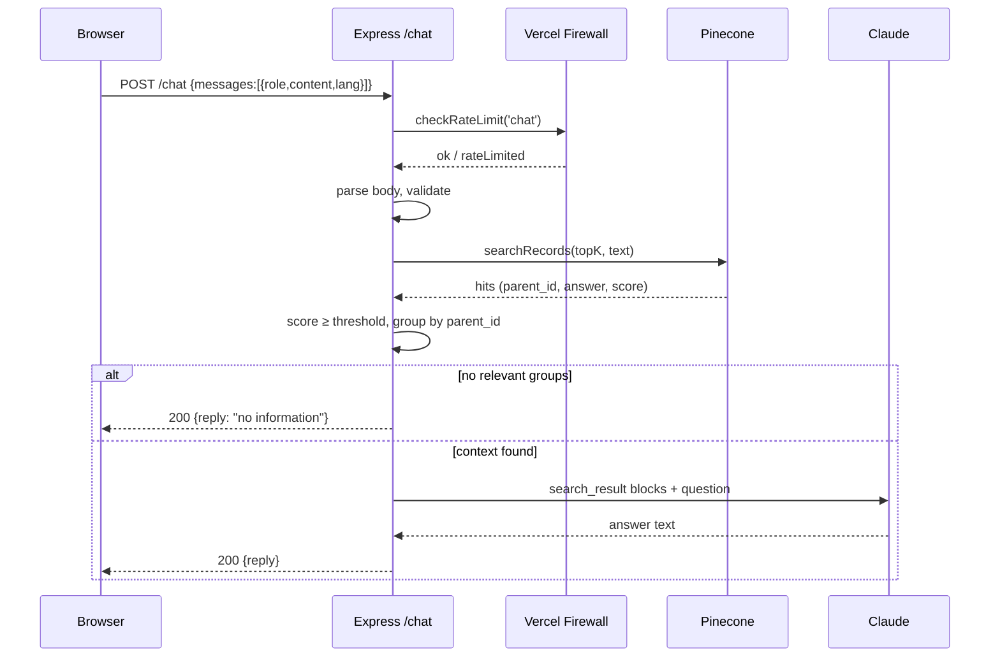

# ai-assistant-node

An AI assistant for a personal website: a visitor asks a question in the chat, the service finds relevant facts in a vector database and asks Claude to compose an answer **based only on what was found**. If there is no relevant data, Claude is not called and the user gets a fixed reply. This prevents invented facts and reduces costs.

Reply languages: Ukrainian, English, Polish.

## Stack and technologies

| Layer | Technology | Role |
|---|---|---|
| Runtime | Node.js 22, ESM | server code with no build step |
| HTTP | Express 5 | `POST /chat` and static file serving |
| LLM | Anthropic Claude (`@anthropic-ai/sdk`) | generates the answer from retrieved context (`search_result` blocks) |
| Vector search | Pinecone (integrated embedding, `@pinecone-database/pinecone`) | semantic search over the FAQ |
| Rate limit | Vercel Firewall (`@vercel/firewall`) | 20 requests / 10 min per IP |
| Frontend | static `index.html` (no frameworks) | personal site with a chat |
| Hosting | Vercel (Root Directory = `frontend`) | serverless function + static files |
| Tests | Jest | no network, fakes for rate-limit / retrieval / claude |
| Local development | Docker Compose (`node:22-alpine`) | run without installing Node |
| Change process | OpenSpec (`spec-driven`) | planning changes through specs |

## Diagrams

```mermaid
flowchart LR
    U[Visitor] -->|browser| FE[public/index.html]
    FE -->|POST /chat| API

    subgraph Vercel["Vercel (frontend/)"]
        API[Express app<br/>src/index.js]
        API --> RL{Rate limit<br/>Vercel Firewall}
        RL -->|ok| V[Validation<br/>language, length, role]
        RL -->|over limit| R429[429]
        V -->|error| R400[400]
        V --> S[Search<br/>src/retrieval.js]
        S --> G[Filter score ≥ VECTOR_MIN_SCORE<br/>group by parent_id<br/>optional rerank ≥ RERANK_MIN_SCORE]
        G -->|no groups| ND[Fixed reply<br/>"no data"]
        G -->|has groups| C[Claude call<br/>src/claude.js]
    end

    S <-->|searchRecords| PC[(Pinecone)]
    C <-->|messages.create| CL[Anthropic API]

    SEED[scripts/seed-pinecone.js] -->|upsert| PC
    DATA[data/faq.sample.json] --> SEED
```

### Request sequence



## Repository layout

```
frontend/          everything that gets deployed (Vercel Root Directory)
  public/          static site (index.html, favicon)
  src/             Express app: index, local, config, log, messages,
                   validate, rate-limit, retrieval, claude
  scripts/         seed-pinecone.js — fills the index
  test/            Jest
data/              faq.sample.json — source data for seeding
docker/            docker-compose.yml for local development
openspec/          specs and changes (spec-driven workflow)
```

Server code must never go under `public/`: Vercel serves that folder as static files.

## Quick start

```bash
cd frontend
cp .env.example .env        # fill in ANTHROPIC_API_KEY, PINECONE_*
npm ci
npm run seed -- --dry-run   # preview records without writing
npm run seed                # fill Pinecone
npm run dev                 # http://localhost:3000
npm test
```

With Docker (from the repository root):

```bash
docker compose -f docker/docker-compose.yml up
```

## Key decisions

- **RAG without inventions.** Claude receives only the retrieved fragments, and the system prompt forbids using any other knowledge.
- **Relevance threshold.** Hits with `score < VECTOR_MIN_SCORE` are dropped. If none remain, the reply is fixed (`src/messages.js`) and Claude is not called. With `RERANK_MODEL` set (off by default), the remaining groups are reranked and filtered by `RERANK_MIN_SCORE` first. Related-but-unanswering results (jokes, credentials, other people) are refused by a rule in the system prompt.
- **Chunks and grouping.** Each FAQ item is stored as several chunks sharing the same `parent_id` and `answer`. After search they are collapsed into one source with the highest score.
- **Abuse protection.** Rate limiting at the Vercel Firewall level, plus limits on the number and length of messages. Rate limiting is off locally.
- **Testability.** `createApp(deps)` accepts its dependencies (`search`, `answer`, `isRateLimited`, `log`), so tests never touch the network.

## Documentation

The `/chat` contract, response statuses, environment variables, Pinecone setup and Vercel deployment are described in [`frontend/README.md`](frontend/README.md).

## License

See [`LICENSE`](LICENSE).
